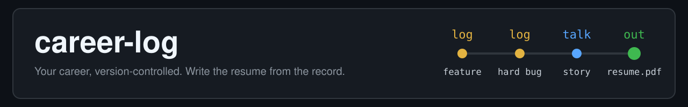

English | [繁體中文](README.zh-TW.md)

# career-log: an AI career journal and resume builder for Claude Code, Codex, Cursor and Antigravity

   

  

A GitHub template for keeping a career log (a "brag document") in git and letting your AI coding agent turn it into tailored resumes, cover letters, job application answers and interview prep. Every claim it writes traces back to a dated record, so it can't invent anything, and nothing you logged gets lost.

- **Hand over what you have:** old resumes, LinkedIn exports, AI chat histories. You don't type your history in.
- **No commands to learn:** say what you want, in your own words and any language.
- **Log from any project:** "log this to my career log" adds a dated line without pulling you out of your work.

## Quick start

1. On GitHub, click **Use this template**, and make your repo **Private**: it will hold your personal records.
2. Clone it, open your coding agent in the repo, and say: **"introduce this repo and set me up"**. It tells you what it can do, sets up this machine (for your user only) and asks a few questions, each with a suggested answer.
3. Hand over what you have ("import my old resumes"), then ask for what you need ("apply to <posting URL>"). Not sure what comes next? Ask "what next?".

## Support

- **Systems:** macOS, Windows and Linux.
- **Agents:** tested with [Claude Code](https://claude.com/claude-code) (Opus and Sonnet; Sonnet or above recommended). Codex, Cursor and Antigravity should work, but are not tested.
- **Model results:** the per-mode test results, and why Haiku is not supported: [ADR 0008](docs/adr/0008-sonnet-is-the-lowest-supported-model.md).
- **Resumes:** one-page English resumes in the North American style. You and your records can use any language.

**More:** the [guide](docs/guide.md) has every mode with example requests, the setup items, the file map and where the writing rules come from; [SETUP.md](SETUP.md) is per-machine setup.

## Entries

Entries appear here as you log them.

| Period | Entry | Type | Status |
|---|---|---|---|

## Engine repo

This repo was created from the Template at https://github.com/mileschintw/career-log-template, which is the export of the Engine repo, https://github.com/mileschintw/career-log-engine. Report a changed chat-export format or a broken step in the Engine repo, as an [issue](https://github.com/mileschintw/career-log-engine/issues) or a pull request: it is where every fix is made, and the Template takes none. Issues are public: include keys and shapes only, never your records. The import mode drafts the report for you and asks before posting ([import-chats.md](skills/career-log/modes/import-chats.md), step 8).

## Upgrade

To upgrade this Log to a newer Template, ask your agent to "upgrade to the latest Template". The upgrade mode ([upgrade.md](skills/career-log/modes/upgrade.md)) fetches the release and replaces the Engine (the skill, `tools/` and the other files the Template ships), runs the upgrade guide of each release in between with you (a guide is where a release changes your records' format, with your yes), and commits each release's step. It starts only from a clean working tree and pushes nothing until you say yes to the whole upgrade; until then, you can take the Log back to the commit it started from. The Template's [Releases](https://github.com/mileschintw/career-log-template/releases) page says what each release changed.

Between releases, the Engine repo publishes **Dev builds**: tags `v<next version>-dev.<n>` on its [`builds`](https://github.com/mileschintw/career-log-engine/tree/builds) branch. None is promised stable.

What happens to Engine files you changed:

- **A file you edited** is replaced by the release's. Then the agent offers, file by file, to merge your edits back in, and shows you each merged change where it now sits. Your version also stays in git history.
- **A conflict** is a place where the release changed the same lines you did. The file keeps both versions between conflict markers; the agent shows you each one with both sides, and you choose yours, the release's or a mix. Nothing is committed until every conflict is settled.
- **A file the release dropped** is deleted. If you had edited it, the agent shows you your version and asks whether to keep it as your own file or let it go.
- **A file you added** (a mode or a tool of your own) stays. If a release ships a file at the same path, the release's takes it over, and the agent offers to move yours to another path.
- **A file you deleted** comes back as the release has it.
- **Your own `.gitignore` lines** are put back with no question.

The upgrade runs from 0.2.0 on. A Log older than that upgrades to v0.3.2 first, as [its notes](https://github.com/mileschintw/career-log-template/releases/tag/v0.3.2) say, then again from 0.3.2.

## License

MIT, see [LICENSE](LICENSE). The example resume is based on the [r/EngineeringResumes template](https://github.com/r-engineeringresumes/resume-templates) (MIT).
