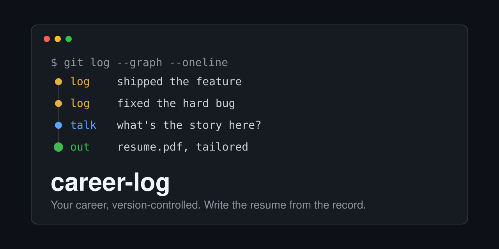

[English](README.md) | 繁體中文

# career-log：給 Claude Code、Codex、Cursor 和 Antigravity 用的 AI 職涯日誌與履歷產生器

   

  

這是一個 GitHub template，用 git 保存職涯日誌（也就是「brag document」），再讓你的 AI coding agent 把它變成量身打造的履歷、求職信、申請表答案和面試準備。它寫出的每一句話都能追溯到一筆有日期的記錄，所以 agent 不會憑空捏造，你記下的事也不會遺失。

- **手上有什麼就全部交給它。** 不必自己把經歷打進去。把舊履歷和 CV、自我介紹、報告、LinkedIn 匯出檔和 AI 聊天記錄交給 agent，或讓它用瀏覽器讀取你已登入的網站。它會把這些併成每段經歷一筆條目。
- **不用學指令。** 呼叫 skill，用你自己的話、任何語言說你想做什麼。它會依你的要求選對模式，一步步帶你完成。
- **在任何專案裡隨時記錄。** PR 合併、專案收尾，或有其他值得記下的事，在你當下所在的 session 說「log this to my career log」。它會加上一行有日期的記錄並 commit，不會打斷你手上的工作。
- **規則可以由你改寫。** [writing.md](skills/career-log/writing.md) 裡的寫作規則是預設值。你在 `direction.md` 寫下的偏好與它不同時，以你的為準；你在使用過程中說出的偏好，skill 也會記下來，所以規則會隨著使用越來越貼近你。你的背景也是一項設定，而不是內建的假設：需不需要簽證贊助、雇主怎麼排序、每個履歷版本以什麼為重點（見[你的設定](#你的設定)）。
- **你的作業系統、你的 agent。** 支援 macOS、Windows 和 Linux，可搭配 Claude Code、Codex、Cursor 和 Antigravity 使用。目前只有 [Claude Code](https://claude.com/claude-code) 完整測過；其他應該大致可用，但沒在 Windows 上測過。

## 快速開始

1. 在 GitHub 按 **Use this template** 建立自己的 repo，並設為 **Private**：這裡會放你的個人經歷。
2. 把它 clone 到電腦上，在 repo 根目錄開你的 coding agent，對它說「照 SETUP.md 幫我設定這台電腦」。它會設定 git 身分、把 skill 連到你的 agent 讀取的 skill 資料夾（SETUP.md 第 4 步）、安裝 LaTeX 工具並跑檢查。
3. 手上有什麼就交出來。把舊履歷和 CV（PDF、`.tex`、Word）、自我介紹、報告和 LinkedIn 匯出檔放進 `sources/inbox/`，說「import my old resumes」。AI 聊天記錄就說「import my ChatGPT history」（或 Claude、Gemini、Perplexity），agent 會告訴你怎麼匯出；下載下來的檔案原樣放進來就好，壓縮或解壓縮都可以，agent 會自己找到裡面的匯出檔。已登入的網站就說出網站名稱；這部分需要有瀏覽器工具的 agent。
4. 之後在任何專案完成一件值得記的事，說「log this to my career log」；要投履歷時，貼職缺網址說「apply to <網址>」；要一份可重複使用的版本，就說「write a backend engineer resume」。

第一次使用時（第一次不只是快速記一筆的 session），agent 也會提議問你一輪設定相關的問題（目標職位、工作身分、雇主怎麼排序、記錄語言、大量變更走 pull request）；任何一題都可以跳過，等第一次需要答案時它會再問，或維持預設值（見[你的設定](#你的設定)）。

你可以用任何語言跟你的 agent 對話。記錄預設用英文寫（可在 `direction.md` 改），每份產出各自選語言。範例資料在 `skills/career-log/examples/`，只是格式示範，不會被當成你的經歷。

## 功能

- **職涯日誌 / brag document**：每份工作、專案或課程一個 Markdown 檔，內含有日期的記錄，外加一份行為面試題的故事庫。
- **客製化履歷**：一頁的 LaTeX 履歷（ATS 友善的 PDF），由 `tools/resume.py` 編譯並檢查版面。可以針對單一職缺做一份、每個目標職位各做一份，或做一份通用版；每份在你看到之前，都先由第二個 agent 審閱。第一次要某個職位的版本時，agent 會問你這份要以什麼為重點，並把答案存進 `direction.md`。
- **適合度判斷**：貼上職缺網址，動筆之前先判斷值不值得投：拿你的硬性條件（例如工作身分）對照職缺、這個職位在你的目標裡排第幾，以及每項職缺要求對應到哪筆記錄能證明，或標成缺口。只問適合度的話，它就停在這裡。
- **投遞職缺**：申請表上的開放式問題，依你的記錄作答。表單其他欄位和投遞追蹤交給你自己的工具。針對單一職缺做的履歷，會和職缺、答案存在一起；你自己上傳的可重複使用版本，則用 git 歷史和投遞日期找回當時那份檔案（上傳時保留它的檔名）。
- **面試準備**：根據雇主會讀到的資料整理準備包，再進行模擬面試。
- **技能缺口分析**：針對一個夢想職缺或一批職缺，產出一張區分「有記錄證明」和「只是自稱」的技能缺口熱圖，以及以專案為主的學習計畫。適合度判斷決定要不要投，這裡決定要學什麼。
- **雇主排序**：先依你的硬性條件，再依你自己的排序方式（領域契合度、規模、薪資等），排序徵才博覽會的名單或職缺清單。
- **匯入**：把舊履歷和 CV（PDF、Word、LaTeX）、自我介紹、報告、LinkedIn 匯出檔、AI 聊天記錄（ChatGPT、Claude.ai、Gemini、Perplexity）和已登入的網站，併成每段經歷一筆條目。讀取網站，以及沒有匯出功能的 Perplexity，需要有瀏覽器工具的 agent。
- **來源追溯**：每份產出都附一張表，把每項陳述連到它的來源記錄。

## 寫作規則從哪裡來

[writing.md](skills/career-log/writing.md) 的每條規則都在小括號裡註明來源，分成兩種。

**公開的指南**，任何人都能查證：
- [r/EngineeringResumes wiki](https://www.reddit.com/r/EngineeringResumes/wiki/index/) 和它的 [sample bullet points](https://www.reddit.com/r/EngineeringResumes/wiki/sample-bullet-points/)（`r/ER`）：一頁、條列項目（bullet）的寫法（XYZ、STAR）、開頭動詞、Skills 區塊。
- [r/EngineeringResumes LaTeX 範本](https://github.com/r-engineeringresumes/resume-templates)（`r/ER`，MIT）：`tools/resume.py` 編譯並檢查的履歷版面。
- [humanizer](https://github.com/blader/humanizer)，根據 Wikipedia 的 [Signs of AI writing](https://en.wikipedia.org/wiki/Wikipedia:Signs_of_AI_writing)（`humanizer`）：AI 痕跡檢查。
- [r/cscareerquestions 履歷指南](https://www.reddit.com/r/cscareerquestions/comments/1577dm9/the_ultimate_guide_to_writing_your_resuume_for/)，作者是會審閱履歷的資深工程師（`r/csCQ`）：採用兩條規則，即什麼時候列 GPA，以及優先挑有真實使用者的專案。
- [Tech Interview Handbook 履歷指南](https://www.techinterviewhandbook.org/resume/)（`TIH`）：採用兩條規則，即縮寫要寫出全稱，以及用純文字檢查 ATS 的讀取。它的格式建議與 r/ER 衝突，其餘不採用。

**從真實求職得到的經驗**，是一般指南沒寫到的。來源是作者用這個 skill 準備真實申請時做的判斷（`practice`），以及招募人員、用人團隊的工程師和同儕的建議（`feedback`）。舉幾條：
- 條列先寫你做了什麼，數字放在後面：以數字開頭，讀者就找不到你的貢獻。（同儕的建議）
- 學生或應屆畢業生，畢業日期放在讀者一眼就看得到的地方。（招募人員的篩選順序，由同儕轉述）
- Skills 列出的技能，也要出現在某條條列裡：招募人員先拿 Skills 對照職缺，再找用到這些技能的經歷。（同一位招募人員的看法）
- 軟實力以 1–3 項證據寫進技術條列，不另開條列。（用人團隊工程師的建議）
- 指標的名稱要寫出確切量測的東西（「p95 queue wait」，而不是「p95 latency」）。（真實申請的審閱流程抓到的）
- 職缺用了概括性的詞時，把那個詞寫進條列，放在具體工具旁邊。（真實申請的關鍵字掃描分數偏低）
- 成果指標勝過「抓到多少失敗」的指標，測試數量也不算影響力。（作者撰寫時的判斷）

和這裡的每條規則一樣，這些都是你可以改寫的預設值（見本頁開頭）。

## 適用範圍與限制

這個 skill 是為**北美風格的英文履歷**設計的：一頁、遵循 [writing.md](skills/career-log/writing.md) 的規則、使用內附的 LaTeX 範本。你可以用任何語言跟 agent 對話，記錄也可以用任何語言寫；適用範圍指的是它產出的履歷。

其他語言和履歷風格要等三項規劃中的功能：自訂履歷範本、Typst 範本，以及 CJK（中文、日文、韓文）履歷。即使這些功能完成，其他語言或風格的履歷**效果可能仍不如**北美英文履歷。這些功能會延伸這套為北美風格建立並測試的設計，也不會另外加入針對其他市場調整的規則。

## 使用方式

呼叫 skill，說你想做什麼。`career-log` skill（在 [`skills/career-log/`](skills/career-log/SKILL.md)）連到你的 agent 讀取的 skill 資料夾之後（見 [SETUP.md](SETUP.md) 第 4 步），在上述任何 agent 的任何 session 都能用，並會依你的要求選模式。下表列出你可以要求的事。引號裡的句子只是範例，怎麼說都行。

| 你可以要求 | 模式 |
|---|---|
| "log this to my career log" | **log**：在某筆條目加一行有日期的記錄 |
| "consolidate the <project> entry" | **consolidate**：補齊每個段落，針對缺口追問你 |
| "prep me for the <company> interview" | **interview**：根據對方會讀到的資料整理準備包，再進行模擬面試 |
| "what should I learn for these postings"、"how do I close the gap to <posting URL>" | **upskill**：以證據為本的技能缺口熱圖，以及以專案為主的學習計畫 |
| "rank these career fair employers" | **rank**：依你的硬性條件和排序方式分級，並為每個排名前面的雇主準備一句開場白 |
| "apply to <posting URL>"、"how well do I fit <posting URL>"、"write a backend engineer resume" | **write**：針對職缺的適合度判斷；針對該職缺、目標職位或通用版的履歷；申請表答案和求職信。給雇主看的草稿會由第二個 agent 審閱，並附來源追溯表 |
| "import my old resumes"（檔案放在 `sources/inbox/`，或透過 agent 的瀏覽器讀取已登入的網站） | **import**：把舊文件併入條目 |
| "import my ChatGPT history"（或 Claude、Gemini、Perplexity） | **import**：告訴你怎麼匯出，逐一篩選每段對話，只複製你挑的那些；原始匯出檔不進 git |
| "audit my career log" | **audit**：列出缺少的故事、缺口和矛盾 |

建議安裝 [humanizer](https://github.com/blader/humanizer) skill。不論有沒有裝，這個 skill 都會自己檢查 AI 寫作痕跡（[writing.md](skills/career-log/writing.md)）；裝了 humanizer 的話，每份要給雇主看的產出也會再跑一次 humanizer。

## 你的設定

skill 的部分行為取決於你是誰，而不是一般的履歷規則：需要簽證贊助的職位算不算出局、雇主排序時什麼優先、某個職位的履歷以什麼為重點。這些都不是寫死的，而是存在你自己的 `direction.md` 裡，你可以隨時查看和修改。

| 設定 | 影響什麼 | 存在哪裡 | 還沒設定時 |
|---|---|---|---|
| 目標職位 | 適合度判斷裡，職缺的職位在你的目標中排第幾；雇主排序時，領域契合度拿什麼來比 | `direction.md › Target roles, ranked` | 第一次有適合度判斷、雇主排序或技能缺口分析需要它時會問你。跳過的話，適合度判斷不給排名，雇主排序依你的記錄顯示的領域，技能缺口分析則把每個職缺看得一樣重 |
| 工作身分 | 適合度判斷的投或不投，以及雇主排序要查什麼（簽證贊助、公民身分、安全許可） | `direction.md › Constraints` | 第一次有職缺、雇主排序或面試準備需要它時會問你。在那之前不設門檻：適合度判斷會列出職缺的相關要求，讓你自己確認 |
| 其他硬性條件（地點、到職日、職級） | 同樣影響投或不投 | `direction.md › Constraints` | 沒有限制；隨時可以加 |
| 雇主排序方式 | 過了硬性條件之後，`rank` 怎麼排雇主 | `direction.md › Employer preferences` | 第一次排序時會問你，建議的答案是先看領域契合度，再看規模和薪資 |
| 履歷版本的重點 | 每個目標版本先放哪些記錄、略過哪些 | `direction.md › What to emphasise, by target` | 第一次要那個目標的版本時會問你 |
| 寫作偏好 | 改寫 [writing.md](skills/career-log/writing.md) 裡的規則 | `direction.md › Writing preferences for applications` | 照 writing.md |
| 記錄語言 | Log 檔案用什麼語言寫 | `direction.md › Writing preferences for applications` | 英文 |
| 大量變更走 pull request | 匯入和其他跨多筆經歷的修改是否先放到分支上，讓你以 pull request 審閱 | `direction.md › Repo workflow` | 關閉 |

`profile.md` 裡的事實也會影響產出，但它們是記錄，不是設定：例如投遞類型不同、畢業日期也不同時，只有 `profile.md › Education` 和它的 Conflicts 有記錄才會用到。

**會怎麼問你。** 新的 Log 一開始有三項設定標成 `GAP:`，也就是沒有預設值的那三項：目標職位、工作身分和雇主排序方式。第一次使用時（第一次不只是快速記一筆的 session），agent 會提議針對這三項，加上記錄語言和大量變更走 pull request，問你一輪問題，每題附建議答案、每題都能跳過，問完記下日期。在這一輪跳過的 `GAP:` 設定，會由第一次需要它的模式再問一次；再跳過的話，agent 會把它標成已跳過，不再追問。有預設值的設定跳過的話，就維持預設值。其他設定會在第一次需要時才問（履歷版本的重點，是在你第一次要那個目標的版本時；不回答的話，agent 會依記錄的標籤自己挑，之後不再追問），或維持預設值。設定還沒回答之前，沒有任何事會因此卡住。從匯入的資料（舊履歷、聊天記錄）裡找到的工作身分或目標職位，會先請你確認，不會直接套用。

**怎麼設定或修改。** 在對話裡用你自己的話說就好：「我不需要簽證贊助」、「雇主排序以薪資優先」、「後端版本以金流專案為重點」。agent 會把它連同日期寫進對應的檔案並 commit。你也可以自己編輯檔案：把整段 `GAP: …`（包括 `(skipped, …)` 註記）換成你的答案，後面加上 `(user, YYYY-MM-DD)`。

**「沒有」也是答案。** 「沒有限制」會像其他答案一樣記下來，agent 就不會再問。沒有預設值的設定，想再被問一次，就把 `GAP:` 放回去（已跳過的，則刪掉它的 `(skipped, …)` 註記）。第一次的設定問答之後，有預設值的設定不會再被問；想改就直接說。刪掉一行的話，有預設值的設定（記錄語言、大量變更走 pull request）會回到預設值；沒有預設值的設定，則會在第一次需要時再問你。

## 條目

條目索引只放在英文版 [README.md](README.md#entries)，你每記一筆，skill 就會更新它。

## 檔案

- [`profile.md`](profile.md)：聯絡方式、學歷、語言、技能摘要
- [`stories.md`](stories.md)：行為面試題類型 → 故事，以及常見申請題 → 素材
- [`applications.md`](applications.md)：這個 repo 準備過材料的申請、徵才博覽會和招募人員聯絡記錄
- [`direction.md`](direction.md)：目標職位、雇主偏好、限制條件、要強調的重點、語言
- `entries/`：每段經歷一個檔案（[範本](entries/_template.md)）
- `outputs/`：產出的文件，每份都附來源追溯表：`applications/`（每個申請一個資料夾，送出後就不再更動）、`resumes/`（每個履歷方向一份持續更新的檔案，舊版本留在 git 歷史裡）和 `reports/`（加上日期的排名和其他報告）
- [`SETUP.md`](SETUP.md)：每台電腦的設定（macOS、Windows、Linux）
- `tools/`：LaTeX 安裝腳本、`resume.py`（編譯並檢查履歷版面；用法見 [latex.md](skills/career-log/latex.md)）、`chat_export.py`（篩選並擷取 AI 聊天匯出檔；用法見 [import-chats.md](skills/career-log/modes/import-chats.md)）和它在 `tools/tests/` 的測試，以及 `export-template.sh`（從你的 repo 建出可分享的 Template）
- `skills/career-log/`：skill 本身、它的[寫作標準](skills/career-log/writing.md)和[範例](skills/career-log/examples/README.md)
- `sources/`：匯入的原始檔、匯入收件匣（`inbox/`）、[匯入記錄](sources/import-log.md)和[來源代號](sources/keys.md)
- [`GLOSSARY.md`](GLOSSARY.md) 和 [`docs/adr/`](docs/adr/)：這個 repo 的詞彙和設計決策

## 上游

這個 repo 是從 https://github.com/mileschintw/career-log-template 這個 Template 建立的。聊天匯出格式改了或某個步驟壞了，請到那裡回報：開 issue（用「Chat export format changed」表單）或發 pull request。Issue 是公開的：只附欄位名稱和結構，絕不附你的記錄。import 模式會幫你草擬回報，貼出前會先問你（[import-chats.md](skills/career-log/modes/import-chats.md) 第 8 步）。

## 授權

MIT，見 [LICENSE](LICENSE)。範例履歷改自 [r/EngineeringResumes 範本](https://github.com/r-engineeringresumes/resume-templates)（MIT）。
