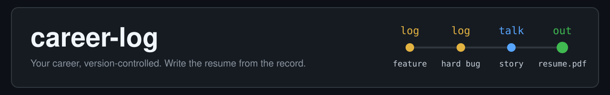

[English](README.md) | 繁體中文

# career-log：給 Claude Code、Codex、Cursor 和 Antigravity 用的 AI 職涯日誌與履歷產生器

   

  

這是一個 GitHub template，用 git 保存職涯日誌（也就是「brag document」），再讓你的 AI coding agent 把它變成量身打造的履歷、求職信、申請表答案和面試準備。它寫出的每一句話都能追溯到一筆有日期的記錄，所以 agent 不會憑空捏造，你記下的事也不會遺失。

- **手上有什麼就交給它：** 舊履歷、LinkedIn 匯出檔、AI 聊天記錄。不必自己把經歷打進去。
- **不用學指令：** 用你自己的話、任何語言說你想做什麼。
- **在任何專案裡記錄：** 說「log this to my career log」，它就加上一行有日期的記錄，不會打斷你手上的工作。

## 快速開始

1. 在 GitHub 按 **Use this template**，並把你的 repo 設為 **Private**：這裡會放你的個人經歷。
2. 把它 clone 下來，在 repo 裡開你的 coding agent，對它說：**「introduce this repo and set me up」**（用中文說也可以）。它會告訴你它能做什麼、設定這台電腦（只裝在你的使用者帳號下），並問你幾個問題，每題都附建議答案。
3. 把手上有的交給它（「import my old resumes」），再提出你要的東西（「apply to <職缺網址>」）。不知道下一步做什麼？問它「what next?」。

## 支援

- **作業系統：** macOS、Windows 和 Linux。
- **Agent：** 已在 [Claude Code](https://claude.com/claude-code) 測過（Opus 和 Sonnet；建議用 Sonnet 以上）。Codex、Cursor 和 Antigravity 應該可用，但沒有測過。
- **履歷：** 北美風格的一頁英文履歷。你和你的記錄可以用任何語言。

**更多：** [guide](docs/guide.md)（英文）列出每個模式和範例說法、設定項目、檔案地圖，以及寫作規則的來源；[SETUP.md](SETUP.md) 是每台電腦的設定。

## 條目

條目索引只放在英文版 [README.md](README.md#entries)，你每記一筆，skill 就會更新它。

## 上游

這個 repo 是從 https://github.com/mileschintw/career-log-template 這個 Template 建立的。聊天匯出格式改了或某個步驟壞了，請到那裡回報：開 issue（用「Chat export format changed」表單）或發 pull request。Issue 是公開的：只附欄位名稱和結構，絕不附你的記錄。import 模式會幫你草擬回報，貼出前會先問你（[import-chats.md](skills/career-log/modes/import-chats.md) 第 8 步）。

要把這個 Log 升到較新的 Template，請跟你的 agent 說「升級到最新的 Template」。upgrade 模式（[upgrade.md](skills/career-log/modes/upgrade.md)）會抓下那個版本、換掉 Engine、跟你一起依序跑中間每個版本的升級指引、問你要不要把你自己改過的 Engine 檔合併回去，等你說好才 commit。每個版本改了什麼，寫在 Template 的 [Releases](https://github.com/mileschintw/career-log-template/releases) 頁面。0.1.0 以前建立的 Log，從 [v0.1.0](https://github.com/mileschintw/career-log-template/releases/tag/v0.1.0) 的指引開始。

## 授權

MIT，見 [LICENSE](LICENSE)。範例履歷改自 [r/EngineeringResumes 範本](https://github.com/r-engineeringresumes/resume-templates)（MIT）。
